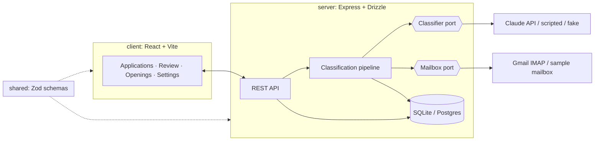
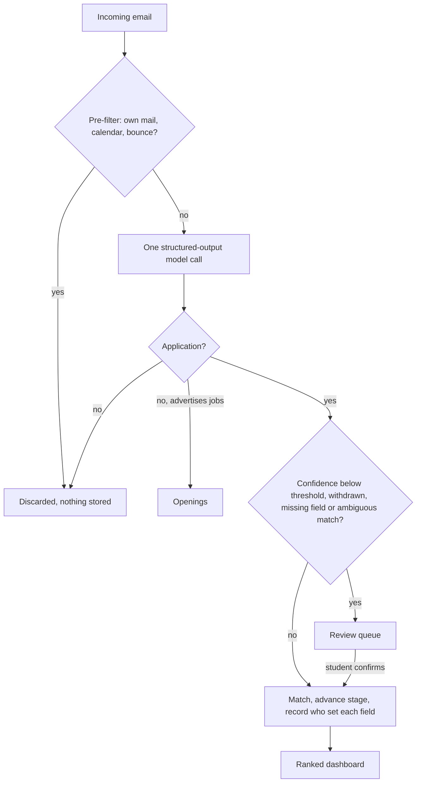

# GradTracker: Final Project Report

*Initial draft, 2 November 2026, generated by Claude Code from this repository and
`docs/final-report-plan.md`. It is a starting point. The team should rewrite it in its own words
in the edit-logged Google Doc. Text in [square brackets] needs checking or completing before it
goes in. The word count covers sections 1 to 7 only.*

---

**FACULTY OF INFORMATION TECHNOLOGY**
FIT3164 Data Science Project Part 2, Semester 2, 2026

**GradTracker: Final Report**

Group: DS-10
Team: Jordan Psomas · William Moreton · Athan Vass
Due: 2/11/2026
Word count: 3,526 (Sections 1 to 7, excluding headings, figures, tables and captions)

---

## Authorship Statement

[To be completed once sections are allocated. Template:]

Jordan Psomas (JP) drafted and finalised [sections]. William Moreton (WM) drafted and finalised
[sections]. Athan Vass (AV) drafted and finalised [sections]. All three members reviewed the
complete report. The use of generative AI is acknowledged in Section 9.

---

## 1. Introduction

For university students applying for graduate and internship roles, it is common to be submitting applications to many employers at once. Each of these applications generates its own stream of recruitment emails such as confirmations, online assessment invitations, interview requests, rejections and in the successful cases an offer. These arrive alongside job alerts, careers newsletters and recruiter outreach, which means the emails that actually require action end up buried in a general inbox. Looking at the data from Prosple we can see domestic students averaged twelve applications each in 2024, a 71% increase from 2022 [1], while graduate job postings fell 21% over the same period [2]. This is interesting as it means students are now managing more applications for fewer roles, and most of them are tracking these manually or not at all.

GradTracker is a web application designed specifically to address this problem. It reads a student's job-related emails and turns them into a tailored, ranked dashboard of their applications. For each email, a large language model (LLM) decides whether it relates to an application the student has made, and if it does, extracts the company, role, stage, deadline and next action. The dashboard then orders these applications by what needs the student's attention first. When the model is unsure, the email is sent to a review queue rather than being treated as fact, and any corrections the student makes are kept until a newer email says otherwise. Additionally, the jobs advertised in job alerts from popular job boards such as SEEK are stored and shown on a separate Openings page, thus allowing the student to decide which roles are worth applying for.

As a data science project, GradTracker also investigates how accurately an LLM can classify and extract information from recruitment emails, and just as importantly how that accuracy should be measured honestly. Overall, the final system meets five of its ten requirements in full, four in part and defers one (Appendix A).

This report presents the final outcomes of GradTracker, developed by group DS-10. Section 2 updates the background and literature from our proposal, Section 3 outlines the project outcomes, Section 4 describes the methodology and Section 5 presents a sample of the code. Finally, Section 6 critiques how the project ran against the original plan and Section 7 concludes with a summary of the project.

## 2. Background

**Context:** Graduate recruitment in Australia runs on fixed intake cycles with multi-stage selection: an application, then an online or video assessment, then interviews or an assessment centre. Full-time employment among new domestic undergraduates fell from 79% to 74% in one year [3], while graduate job postings fell 21% over the same period[2], so students apply more widely. Domestic students average twelve applications each in 2024, up 71% on 2022 [1], and each extra application adds more email to track. Every employer already communicates through email, which makes the inbox the one place where a complete record of a student's applications exists without any employer integration. The target users are final-year students and recent graduates with ten or more applications open at once.

**Literature and existing tools:** The proposal cited work showing that LLMs extract structured fields reliably when the target fields are defined explicitly [4], [5], and proposed a two-stage pipeline: classify, then extract. Since the proposal, the build instead uses a single call whose output is constrained to a JSON schema [6], so the response is always parseable and each email costs one call instead of two. Research on human-in-the-loop machine learning argues that model outputs should not be treated as final where errors are costly, and that keeping the user in control builds trust [7], [8]. This directly motivated the review queue and the correction rules: every extracted field is editable, edited fields are marked as user-corrected, and corrections persist for later emails. For evaluation, Sokolova and Lapalme show why precision and recall must be reported separately rather than accuracy alone [9]; for GradTracker, a missed recruitment email costs far more than a false alarm. Our test sets are small and the expected accuracy is close to 1, and at that scale the usual normal-approximation interval is unreliable [10]. We therefore report the Wilson score interval [11], which stays inside [0, 1]. Among existing tools, re-checked in November 2026, Huntr still requires every application to be entered manually or clipped via its browser extension [12], JobShinobi still processes only emails the user forwards, and only on its paid plan [13], and Simplify fills in application forms but never reads the inbox [14]. A newer tool, JobSnap, also relies on forwarding and deliberately avoids connecting to Gmail for privacy reasons [15]; GradTracker accepts that trade-off for complete coverage, which is why security (R15) is central to its design. No tool we found reads the inbox, classifies emails automatically and keeps the student in control of the result.

## 3. Outcomes

### 3.1 What was delivered

GradTracker is a working web application (screenshots in Appendix B). A student creates an account, connects the demonstration Gmail inbox and runs an initial scan. The scan reads the inbox and builds three views:

- **Applications** ranks every live application by urgency and shows its stage, deadline and next action. A search box and stage filters narrow the list without re-ordering it. Opening a row shows the extracted fields and a timeline of the emails behind them (Figure B1).
- **Review** holds emails the system is unsure about. The student can confirm, edit, mark as not an application, or answer "is this the same application?" (Figure B3).
- **Openings** lists jobs advertised in job alerts and careers emails. These are never treated as applications, but the student can mark one "I've applied" to start tracking it (Figure B4).

During the final demonstration, three emails were sent to the inbox live. Pressing **Sync inbox** read them through the same pipeline: one updated an existing application, one went to review at confidence 0.47, and one added two openings.

### 3.2 Requirements met and not met

Table 1 summarises the status of each of the ten requirements, as outlined in RTM v4 (Appendix A).

| Requirement | Status | Evidence |
|---|---|---|
| RQ-01 Gmail access without stored credentials | Deferred | Product schema holds no credential (automated test); OAuth round-trip not built |
| RQ-02 Ingestion and refresh | Complete | Duplicate-protection tests; live Sync in the demo |
| RQ-03 Classification ≥95% | Partial | Pipeline, prompt and accuracy harness built and tested; no model measured |
| RQ-04 Extraction and deadlines ≥95% | Partial | Six-stage assignment and deadline rules tested; not measured |
| RQ-05 Ranked dashboard | Complete | Ranking tests; ordering independent of arrival order and screen width |
| RQ-06 Corrections and review | Complete | Tests on who set each field; "newer email wins" shown live |
| RQ-07 Privacy | Complete | No stored field can hold email content; search of every stored value |
| RQ-08 Security | Partial | Input validation, per-user isolation, signed session cookie; HTTPS deferred |
| RQ-09 Usability and performance | Partial | Responsive; WCAG 2.1 AA audit 36 pass, 4 partial, 1 not tested |
| RQ-10 Openings | Complete | Route, pipeline and screen tests |

*Table 1: Requirement status at the final demonstration.*

In total, 705 automated tests passed across the three packages at the final build. Performance was also measured at the 95th percentile over 20 timed runs on a seeded dashboard of 25 applications, where we can see loading the ranked dashboard takes 8.0 ms against a 200 ms budget and saving an edit takes 11.2 ms against a 300 ms budget, thus both sit well within their targets (Appendix D).

**Not met.** The most significant gap is that **classification and extraction accuracy have not been measured** (RQ-03, RQ-04). The live classifier is built for Claude Haiku 4.5, which escalates to Claude Sonnet when its confidence falls below 0.6. Running it requires paid API credit, priced at about US$15–20 for the full evaluation, which the team did not purchase. This means the three live emails in the final demonstration were classified by a scripted stand-in, however its output still passed through the real confidence gate, matching and storage. The held-out test set is also unfinished, with about 120 emails exported but not yet labelled. That being said, everything up to the model call is built and tested, so measurement is really only one run away rather than a redesign. RQ-01 was deferred because Gmail's read-only scope is classified by Google as restricted, which means publishing beyond 100 test users requires an annual paid security assessment. Instead, the demo reads its own inbox over IMAP behind a labelled simulation of the consent screen. RQ-08 and RQ-09 are partial for the same reason, as hosted deployment, HTTPS and some of the accessibility fixes against WCAG 2.1 [16] all depend on it.

### 3.3 User feedback

3 students used GradTracker informally after the demonstration. They described it as intuitive and said it did what it set out to do: make it easier to manage and track their current graduate applications. Tutors gave positive feedback on the presentation. This feedback was informal, with no structured questions or task measurements, so it shows the product was well received rather than measuring its usability.

### 3.4 Limitations and future work

Some limitations of our current product are that the confidence score is the model's own rating and has not been calibrated against actual correctness. Meaning there is no comparison or standard of correctness other than from the testing data. The 80 authored test emails were used to tune the prompt, so they cannot measure it. The system runs locally against one demonstration inbox.

**Future work, in order:**

- Buy API credit, freeze the labelled held-out set and run the harness;
- Check confidence calibration;
- Complete Gmail OAuth and hosted deployment over HTTPS;
- Run a structured usability study.
## 4. Methodology

### 4.1 Architecture

GradTracker is a TypeScript monorepo with three packages (Figure 1):

- `shared` holds the data schemas, written once in Zod and used for validation on both sides;
- `server` is an Express API with a Drizzle ORM data layer, running on SQLite with Postgres-compatible schemas;
- `client` is a React single-page application built with Vite.

One language end to end meant one type system from the database to the screen, and one set of tools for three developers. Additionally, the `shared` package ensures the client and server can never disagree. For example, without this package the server could think there are six stages whilst the client thinks seven leading to bugs, thus the package ensures both sides import the same definitions.

The classifier and the mailbox are each defined as an interface ("port") with interchangeable implementations: a fake for tests, a scripted one for demonstrations, and the eventual live one. This decision let the whole product be built and tested before any API access existed, and is why missing credit blocked measurement but nothing else.

*Figure 1: Architecture of GradTracker: the client, the server, the shared schemas, the two ports and the database (source in Appendix G).*

### 4.2 The classification pipeline

As shown in Figure 2, each email passes through five steps:

- **Pre-filter.** Before the model is called, we filter out the student's own sent emails, calendar notifications and bounced emails. This means we do not waste API calls on emails that could never be about an application.
- **Classification and extraction.** Each email gets one model call, which returns a JSON object in a fixed format. For example, for a KPMG email asking the student to "complete your numerical and verbal reasoning assessment by 11:59pm AEDT on Sunday 11 October", it returns:

```json
{
  "isApplication": true,
  "company": "KPMG",
  "role": "Consulting Graduate",
  "stage": "assessment",
  "deadlineAt": "2026-10-11T12:59:00Z",
  "nextAction": "Complete numerical and verbal reasoning assessment",
  "confidence": 0.96
}
```

We can see the deadline is stored in UTC, which is why 11:59 pm in Melbourne becomes 12:59. For a job alert on the other hand, isApplication comes back as false, along with a list of the openings in it (the company, role, location, closing date and source of each job). The prompt (version 3) is built around one simple question: has this student already applied, or is this email asking them to apply? This is important because it is what tells a real interview invitation apart from a job alert that also says "apply now". The values shown are the labelled answer for sample email 019, however the confidence is only an example as no model has been run yet.
- **Code gates.** After the model responds, a few simple checks in the code decide where the email goes. If its confidence is below the student's threshold (0.75 by default, which can be changed in Settings), it goes to the review queue instead of the dashboard. An email also goes to review if it says the student has withdrawn, is missing a company or role, or matches more than one existing application. This is because in these cases the student should be the one to confirm what happened.
- **Matching and stages.** The email is attached to an existing application by company and role, or starts a new one. Each application is in one of six stages (Table 2). A new email moves it forward only, so a late confirmation cannot undo an interview invitation; an offer or rejection applies from any stage.
- **Who set each field.** Every field records whether the model or the student set it. A student's correction holds against older or unrelated mail, but an email received after the correction may update the field. This means the dashboard never shows a stale correction over news the student has not seen.
| **Stage** | **Set by an email that…** | **Rank** |
|---|---|---|
| Applied | confirms the application was received | 1 |
| Assessment | invites an online test, coding challenge or video interview | 2 |
| Interview | invites an interview or assessment centre | 3 |
| Offer | offers the role | 4 |
| Rejected | says the application was unsuccessful, at any stage | final |
| Withdrawn | confirms the student withdrew (set only after the student confirms) | final |

*Table 2: Application stages.*

*Figure 2: The path of an incoming email to the dashboard, the review queue, Openings, or discarded (source in Appendix G).*

### 4.3 Data collection and processing

To evaluate the classifier, we used two separate datasets, shown in Table 3. This is because if a dataset has been used to shape the prompt, it cannot then be used to fairly test it.

|  | Tuning set | Held-out set |
|---|---|---|
| Contents | 80 authored emails: 55 applications across all stages, 25 non-applications (15 deliberately hard, e.g. job alerts, "someone viewed your application") | About 200 real emails from members' own inboxes, roughly half applications and half hard negatives |
| Purpose | Develop the prompt and rules; demonstration data | The headline accuracy figure |
| Status | Complete; 28 contain a deadline | About 120 exported; labelling pending |

*Table 3: Evaluation datasets.*

The held-out set has deliberately been given more application emails than a normal inbox would have. This is because in a normal inbox about 98% of emails have nothing to do with applications, which means a classifier that just answered "no" to everything would still score 98%. We state upfront that the set is enriched, and we report precision and recall separately instead of relying on accuracy alone. Each member only exports their own mail, so nobody reads anyone else's inbox. The labels follow a one-page guide that uses the same rules as the prompt. For example, a field is labelled only from the email itself and not from the rest of the thread, and a deadline given in days ends at 23:59 on the last day. About 25 emails are labelled by two people separately so we can report how often they agree. Finally, before any model sees the set it is frozen and given a fingerprint (a SHA-256 hash) so we can tell if anything changes, and real emails are never put in the repository.

Privacy also affects what gets stored. Only the extracted fields, the sender's domain and the message ID are kept, never the subject or body of the email. The part of the code that reads each email returns a type that has no room for the email's content, which means nothing later on can save it by accident. Every reported percentage is also given with its Wilson 95% interval. For example, with about 200 emails and 97% measured accuracy, the interval runs from roughly 93.6% to 98.6%. Looking at this we can see there is still a fair amount of uncertainty, even with a test set of that size.

### 4.4 Tools and replication

| Area | Tools |
|---|---|
| Version control and testing | Git and GitHub; Vitest for unit, route and screen tests |
| Database migrations | Drizzle Kit (ORM for SQLite and Postgres) |
| Design | Figma, from which the interface was restyled in October |
| Large language model | The Anthropic Messages API with structured outputs |

To replicate the system: clone the repository, run `npm install`, supply the environment variables listed in the README, and run `npm run demo`. The accuracy harness runs as part of the test suite and fails the build if the figures fall below target. Every design decision, with the options rejected, is recorded in `docs/decision-record.md` (43 entries).

## 5. Sample Code

Appendix C lists `rankJobs` and the functions it uses (about 75 lines), with its call from the applications endpoint. The code implements RQ-05: the application needing attention most appears first. The comparator sorts on four keys in order:

- urgency bucket (overdue, then due within 2, 7 and 14 days, then none);
- stage, with an offer ahead of an application;
- time since the last email, oldest first;
- company name.

The fourth key makes the order stable, so the same data always renders the same way. Days are counted as calendar days in the student's own time zone, not as elapsed hours. At 11 pm on a Thursday, a 9 am Friday deadline is "tomorrow", not "0 days". The functions are pure, with no input or output, so they are tested against pipelines with known correct orderings.

## 6. Critique

### 6.1 Execution against the proposal

The product delivered what the proposal set out to do, with the main deviations shown in Table 4.

| Proposal | Delivered | Reason |
|---|---|---|
| React, Node/Express, Python/FastAPI, MySQL, AWS EC2 | TypeScript throughout; SQLite, Postgres-ready; runs locally | One language and type system; no hosting budget |
| Two calls: classify, then extract | One schema-constrained call | One call per email; output always parseable |
| Seven stages (incl. "Follow-up Required", "Deadline Approaching") | Six stages; urgency computed from the deadline | The two dropped stages describe time, not progress, so the system computes them |
| 19 requirements | 10 | TA guidance (19 August) to hold 7–10 broader requirements; RQ-10 added later |
| 95% targets (R12, R13), but R18 said 85% | 95% for classification and deadlines | Inconsistency resolved |
| Gmail OAuth with encrypted tokens | Deferred; demo inbox over IMAP | Restricted scope requires a paid assessment |
| Accuracy tested in Sprint 6 | Harness built; not run | API credit not purchased |
| Not planned | Review queue, tracking of corrections, Openings, demo accounts | Added for trust and for the demonstration |

*Table 4: Proposal versus delivered system.*

Some planned items were overtaken by better ones. The proposal's risk register already proposed a confidence threshold for misclassification (risk R02), and this became the review queue. Others were not delivered. The proposal promised no local installation (R14) and HTTPS (R16), both of which depended on hosting that did not happen.

### 6.2 Project management and schedule

The proposal planned six two-week Scrum sprints tracked on Trello. In practice the team met regularly with written minutes, and worked ad hoc between meetings. Work came in bursts rather than at a steady sprint pace: the repository shows concentrated activity on 16–18 August, 28–29 September and 17–20 October. Two documents kept the plan current as it changed: a decision record (D1–D43) and a task list with named blockers. These meant decisions were written down rather than re-argued. Two scheduling mistakes had lasting effects:

- **Labelling started late.** The decision record set Week 3 as the start, because labelling was the longest-lead task and the only one that turns a demonstration into evidence. It slipped, and the held-out set was not ready in time.
- **API credit was never bought.** It cost about US$20, and buying it in the first sprint would have let the headline requirement be measured.
### 6.3 Communication and supervision

Meetings were minuted, and decisions from them were recorded in the decision record with a date. Formal meetings were held on Zoom roughly every two to three weeks, with shorter check-ins between them, and day-to-day coordination happened in an Instagram group chat. TA feedback shaped the scope directly. The 19 August guidance consolidated 19 requirements into nine. The 6 October meeting led to rewording RQ-03 and RQ-04 and to the rule that a newer email overrides a correction.

### 6.4 Workload

Work was allocated in team meetings and recorded in the minutes. Each member completed the work they took on (Appendix F). In summary, Jordan led the classifier, covering the prompt, the labelled dataset and the evaluation protocol. William led the interface, from the Figma wireframes through to the standalone web page and the review queue, and took on a share of the testing. Athan led the backend, covering login, the database schema, the API routes and the sync between client and server, including the rule for when a manual edit takes precedence over a new email. All 46 commits in the repository were made from one GitHub account, because code was integrated and pushed from one machine. Commit history therefore does not show who did the work; the minutes and this document's edit history do. In hindsight, each member should have committed from their own account. That would have made contributions visible and would have kept the proposal's rule that code is pushed only with the whole team's approval.

## 7. Conclusion

GradTracker set out to turn a student's recruitment email into a single, ranked view of their applications, with the student in control of anything uncertain. The delivered system does this. It ingests email, classifies and extracts through a schema-constrained LLM call, sends uncertain results for review, keeps corrections until newer mail arrives, ranks applications by urgency, and lists advertised openings separately, all without storing email content. Five requirements are complete, four partial and one deferred, and 705 automated tests pass. Early student feedback describes it as intuitive and useful.

The open question is accuracy. The evaluation method is designed and built: a separate tuning set, an enriched and frozen held-out set, precision and recall reported separately, and Wilson intervals. What remains is to label the held-out set, buy API credit and run the harness. After that come confidence calibration and hosted deployment with Gmail OAuth, which would make GradTracker usable beyond the team.

## 8. References

[1] K. Ranara, "Australian graduate recruitment trends in 2024," Prosple, 2024. [Online]. Available: https://recruiters.prosple.com/resources-all/post/australian-graduate-recruitment-trends-in-2024

[2] Indeed Hiring Lab Australia, "Australia's graduate hiring slows," May 2025. [Online]. Available: https://www.hiringlab.org/au/blog/2025/05/01/australia-graduate-hiring-slows/

[3] QILT, "2024 Graduate Outcomes Survey: National report," Australian Government Department of Education, 2024. [Online]. Available: https://www.qilt.edu.au/surveys/graduate-outcomes-survey-(gos)

[4] X. Liu, W. Gao, Z. Ding, Y. Li, and K. Hu, "ERE-LLM: Entity-relation extraction with large language model in professional domains," in Proc. IEEE ICASSP, 2026, pp. 1–5. doi: 10.1109/ICASSP55912.2026.11464200

[5] D. Zhou, R. Li, G. Yang, Z. Du, P. Ren, and R. Wang, "Research and application of power document complex key information extraction based on LLM CoT enhanced fine-tuning," in Proc. 5th Int. Conf. CEI, 2025, pp. 1–6. doi: 10.1109/CEI66465.2025.11398756

[6] Anthropic, "Structured outputs," Claude Docs. [Online]. Available: https://platform.claude.com/docs/en/build-with-claude/structured-outputs

[7] E. Mosqueira-Rey, E. Hernández-Pereira, D. Alonso-Ríos, J. Bobes-Bascarán, and Á. Fernández-Leal, "Human-in-the-loop machine learning: A state of the art," Artif. Intell. Rev., vol. 56, no. 4, pp. 3005–3054, 2023. doi: 10.1007/s10462-022-10246-0

[8] K. Lazaros, A. G. Vrahatis, and S. Kotsiantis, "Human-in-the-loop artificial intelligence: A systematic review of concepts, methods, and applications," Entropy, vol. 28, no. 4, p. 377, 2026. doi: 10.3390/e28040377

[9] M. Sokolova and G. Lapalme, "A systematic analysis of performance measures for classification tasks," Inf. Process. Manag., vol. 45, no. 4, pp. 427–437, 2009. doi: 10.1016/j.ipm.2009.03.002

[10] L. D. Brown, T. T. Cai, and A. DasGupta, "Interval estimation for a binomial proportion," Statist. Sci., vol. 16, no. 2, pp. 101–133, 2001.

[11] E. B. Wilson, "Probable inference, the law of succession, and statistical inference," J. Amer. Statist. Assoc., vol. 22, no. 158, pp. 209–212, 1927.

[12] Huntr, "Huntr vs Teal: Which job search tool works best in 2026?" 2026. [Online]. Available: https://huntr.co/blog/huntr-vs-teal

[13] JobShinobi, "Huntr vs Teal vs Careerflow job tracker comparison," 2026. [Online]. Available: https://www.jobshinobi.com/compare/huntr-vs-teal-vs-careerflow-job-tracker

[14] AutoApplier, "Simplify jobs review," 2026. [Online]. Available: https://www.autoapplier.com/blog/simplify-jobs

[15] D. Dharan, "Job Application Tracker — JobSnap," Chrome Web Store, ver. 1.99, Jul. 2026. [Online]. Available: https://chromewebstore.google.com/detail/nahgglkjpodpiekfeecpghlgpnnchimo

[16] W3C, "Web Content Accessibility Guidelines (WCAG) 2.1," W3C Recommendation, 2018. [Online]. Available: https://www.w3.org/TR/WCAG21/

## 9. Generative AI Acknowledgement

**Claude Code** (https://claude.com/claude-code), running Claude Opus, was used throughout the semester to write and test the application code and its documentation within the repository. It was chosen because it works directly in the codebase and runs the test suite. For this report, Claude Code was used to analyse the brief, rubric and proposal, write a section-by-section plan, and generate this initial draft from the repository's records. This was refined over several sessions in October and November 2026. Claude Code was also used to reword drafted sections closer to each author's own writing style, to build Appendices A, D and E from the repository's records, and to check every reported figure against the repository and the test output, which corrected the dashboard performance figure in Section 3.2 and two notes in the RTM.

**Claude Design** was used to [produce presentation slides; n iterations; modifications]. **Claude** (https://claude.ai), through Claude Code running Claude Opus, was used by Jordan Psomas to plan the report against the brief and rubric, draft Jordan's sections (1, 3.2, 4.2 steps 1 to 3 and 4.3), and build Appendices A, D and E from the repository's records. Jordan's sections went through four rounds of rewording: one to match Jordan's Semester 1 proposal, one to match Jordan's FIT3152 assignments, and plain-English passes on 4.2 and 4.3. Jordan checked each version against the repository and directed the changes, including correcting the dashboard performance figure in Section 3.2, fixing the dataset and API cost notes in the RTM, and replacing technical terms such as "provenance" with simpler wording. [Figma / other tools as applicable.]

---

## Appendices

*Appendices do not count toward the word limit.*

### Appendix A: Requirements Traceability Matrix

Table A1 lists the ten requirements as they stood at the final demonstration (RTM v4, 19 October 2026, with the RQ-03 and RQ-04 notes corrected on 2 November). In total five are complete, four are partial and one is deferred. Eight of the ten are High priority, with RQ-09 and the new RQ-10 being Medium. The full workbook (`GradTracker_RTM_v4.xlsx`) also holds each requirement's source, deliverable, notes on its status and how it was shown live in the demonstration.

| ID | Requirement | Priority | Verification method | Status |
|---|---|---|---|---|
| RQ-01 | The system shall obtain access to the user's Gmail mailbox under a read-only authorisation scope. It shall never ask for or hold the user's Gmail password, and the product database shall store no password or other login credential. | High | Automated inspection of both database schemas confirming no credential or plaintext-token column exists; manual test confirming the application reads mail without the user's Gmail password ever being supplied to it. | Deferred — justified |
| RQ-02 | The system shall retrieve email from the connected mailbox without manual entry by the user, process each message once only, and allow the user to trigger an update on demand. | High | Ingest a known mailbox sample twice and confirm no duplicate applications are created; user test of the refresh control confirming new mail appears without manual entry. | Complete |
| RQ-03 | The system shall determine, for each ingested email, whether it relates to a job application, and attach a confidence score to each determination. Measured on a held-out labelled dataset it was not tuned against, the classifier shall achieve at least 95% accuracy, with precision and recall reported separately. In use, a determination below the user's confidence threshold shall be presented to the user for confirmation rather than asserted as fact (RQ-06). | High | Run the classifier over a held-out labelled dataset it was not tuned against. Report accuracy, precision, recall and false negatives as separate figures, each with a stated confidence interval. | Partial |
| RQ-04 | For each email identified as job-application-related, the system shall extract company, role, application stage, deadline and required next action; assign the application to one of the defined stages; and, of emails stating a deadline explicitly, surface the correct deadline date from at least 95%, measured on the held-out dataset with a stated confidence interval. An interview time, an employer's promised reply time or another applicant pool's closing date is not a deadline. | High | Compare every extracted field against hand-labelled ground truth on the held-out dataset. Score deadline detection separately, on the subset of emails that contain explicit deadline language, and separate date-correct from exact-time-correct results. | Partial |
| RQ-05 | The system shall present all tracked applications in a single browser view showing company, role, stage, deadline and next action, ordered so that the item most urgently requiring the user's attention appears first. | High | User test: a participant with a populated pipeline identifies their most urgent outstanding action from the initial view, without scrolling or re-ordering the table. | Complete |
| RQ-06 | The user shall be able to review and correct every AI-extracted field. Corrections shall be visually distinguishable from AI-generated values and shall persist across subsequent updates, except where an email about that application, received after the correction, states a new value for the corrected field. Extractions below a confidence threshold shall be presented to the user for confirmation rather than asserted as fact. | High | User test: a participant corrects a field and confirms the correction survives an update carrying older or unrelated mail; then an email received after the correction updates that field and the field returns to an AI value. Inspection confirming low-confidence extractions appear for confirmation and do not enter the main pipeline. | Complete |
| RQ-07 | The system shall not persist raw email content. Only structured extracted fields, the sender's domain and the message identifier shall be stored. | High | Automated check that no stored field is capable of holding email content, plus an automated search of every stored value for the subject text, body phrases and sender address of every email in the test dataset. | Complete |
| RQ-08 | The system shall protect user data in transit and at rest, validate all user-editable input, manage user sessions securely, and ensure that no user can access another user's records. | High | Security test suite covering transport encryption, session handling, input validation on every editable field, and an attempted cross-user record access. | Partial |
| RQ-09 | The system shall be usable in a standard web browser with no local installation, remain usable at both mobile and desktop screen widths, meet recognised accessibility standards, and complete dashboard interactions promptly under normal operating load. | Medium | Manual testing across mobile and desktop screen widths; accessibility audit against WCAG 2.1 AA; timed measurement of dashboard render and edit round-trip under a representative data load. | Partial |
| RQ-10 | The system shall identify, from ingested job alerts, job-board emails and careers newsletters, the job openings they advertise, and present them in a separate view showing company, role, location, closing date and source, ordered by closing date. The user shall be able to open the source email, mark an opening as applied (adding it to the tracked applications) or dismiss it. Openings shall never be presented as applications. | Medium | Ingest the labelled dataset and confirm each job alert's openings appear once each, with no application created from any of them; user test: a participant finds the soonest-closing opening, marks it applied and finds it in Applications at Applied. | Complete |

*Table A1: Requirements at the final demonstration (RTM v4).*

Table A2 shows how the 19 requirements from the Semester 1 proposal map onto the condensed set. Following the TA guidance on 19 August to hold roughly 7–10 broader requirements, the nineteen were grouped into nine and none were deleted, thus every Semester 1 requirement can still be traced. RQ-10 (Openings) was then added in v4 from the Semester 2 backlog item "upcoming jobs to apply for", which is why it maps to no Semester 1 requirement.

| S1 ID | Semester 1 requirement (abridged) | Disposition | Now covered by |
|---|---|---|---|
| R01 | Authentication — OAuth 2.0, no credentials stored | Carried forward | RQ-01 |
| R02 | Email fetching — automatic, no manual input | Merged | RQ-02 |
| R03 | Classification — LLM decides job-application or not | Carried forward | RQ-03 |
| R04 | Entity extraction — company, role, stage, deadline, next action | Merged | RQ-04 |
| R05 | Stage categorisation — seven named stages | Merged — scope corrected | RQ-04 |
| R06 | Tracker dashboard — all applications in one view | Carried forward | RQ-05 |
| R07 | Next action suggestion based on detected stage | Absorbed as clause | RQ-04 |
| R08 | Deadline detection from email content | Merged | RQ-04 |
| R09 | Company filter on the dashboard | Absorbed as clause — flagged | RQ-05 |
| R10 | Human-in-the-loop edit of extracted data | Carried forward — broadened | RQ-06 |
| R11 | Manual dashboard refresh button | Absorbed as clause | RQ-02 |
| R12 | Classification accuracy ≥95% on held-out data | Folded in as criterion | RQ-03 |
| R13 | Deadline detection ≥80% where language is explicit | Folded in as criterion | RQ-04 |
| R14 | Accessible via a standard browser, no local install | Merged — scope clarified | RQ-09 |
| R15 | Data privacy — no raw email content persisted | Carried forward | RQ-07 |
| R16 | Web application security — HTTPS, validation, sessions | Carried forward | RQ-08 |
| R17 | Responsiveness — prompt response to interactions | Merged — ambiguity resolved | RQ-09 |
| R18 | Test classification accuracy against held-out data | Promoted to Verification Method | RQ-03 |
| R19 | Verify OAuth restricts access; no credentials; HTTPS | Promoted to Verification Method | RQ-08 |

*Table A2: Consolidation of the 19 Semester 1 requirements.*

### Appendix B: Screenshots

All screenshots were taken from the locally run demo build using the sample mailbox only, never a team member's own inbox. The image files are in `docs/report-figures/`.
B1 Applications dashboard · B2 Application detail with an edited field · B3 Review queue ·
B4 Openings · B5 Settings with the review threshold · B6 Create account and Connect Gmail ·
B7 Sync inbox result.

### Appendix C: Sample code

From `packages/server/src/domain/ranking/rank.ts`:

```ts
/**
 * Whole calendar days between two instants **in a given timezone** — defect C2.
 *
 * Not `(deadline - now) / 86400000`, which measures elapsed time rather than
 * calendar days: at 11pm on Thursday a Friday 9am deadline is 0.4 elapsed days
 * away but is *tomorrow*, and a student reading "0 days" for something due
 * tomorrow is being told the wrong thing.
 *
 * The timezone comes from the client and the server ranks with it, so ranking
 * and display can never disagree about which day it is.
 */
export function daysUntil(deadline: Date, now: Date, timeZone: string): number {
  const startOfDay = (date: Date): number => {
    // en-CA gives ISO-ordered YYYY-MM-DD, which parses back as a UTC midnight.
    const local = new Intl.DateTimeFormat("en-CA", {
      timeZone,
      year: "numeric",
      month: "2-digit",
      day: "2-digit",
    }).format(date);
    return Date.parse(`${local}T00:00:00Z`);
  };

  return Math.round((startOfDay(deadline) - startOfDay(now)) / 86_400_000);
}

/** Attaches the computed fields a job needs before it can be ordered. */
export function score<T extends RankableJob>(job: T, now: Date, timeZone: string): RankedJob<T> {
  const daysLeft = job.deadlineAt === null ? null : daysUntil(job.deadlineAt, now, timeZone);
  const followUpRequired = isFollowUpRequired(job.stage, job.lastEventAt, now);

  return {
    job,
    daysLeft,
    followUpRequired,
    bucket: urgencyBucket(daysLeft, followUpRequired),
  };
}

/**
 * The comparator. Lexicographic, in the order the brief specifies:
 *
 *   1. urgency bucket ascending  — overdue first
 *   2. stage rank descending     — an offer outranks an application
 *   3. lastEventAt ascending     — stalest first
 *   4. company A–Z               — a stable, reproducible tiebreak
 *
 * The fourth key exists so the same pipeline always renders in the same order.
 * Without it, two jobs identical on the first three keys would swap places
 * between requests, which reads as a bug and destroys trust in the ordering.
 */
export function compareRanked(a: RankedJob, b: RankedJob): number {
  if (a.bucket !== b.bucket) return a.bucket - b.bucket;

  const stageDelta = STAGE_RANK[b.job.stage] - STAGE_RANK[a.job.stage];
  if (stageDelta !== 0) return stageDelta;

  const staleness = a.job.lastEventAt.getTime() - b.job.lastEventAt.getTime();
  if (staleness !== 0) return staleness;

  return a.job.company.localeCompare(b.job.company);
}

/** Ranks a pipeline. Input order never affects output. */
export function rankJobs<T extends RankableJob>(jobs: T[], options: RankOptions): RankedJob<T>[] {
  const visible = options.includeTerminal
    ? jobs
    : jobs.filter((job) => !TERMINAL_STAGES.has(job.stage));

  return visible.map((job) => score(job, options.now, options.timeZone)).sort(compareRanked);
}
```

Called from `packages/server/src/routes/jobs.ts` when the dashboard loads:

```ts
// Terminal stages are excluded from Active but must appear on Archived,
// otherwise a rejected job vanishes from the product entirely.
const ranked = rankJobs(rows, {
  now,
  timeZone: req.timeZone,
  includeTerminal: query.status === "archived",
});
```

Each function carries its own documentation comment, and together they implement RQ-05, where the application needing attention most appears first (Section 5).

### Appendix D: Testing and audit summary

Table D1 summarises the automated test suite at the final build, which is run with `npm test` (Vitest) across the three packages.

| Package | Test files | Passing | To-do |
|---|---|---|---|
| shared | 1 | 18 | 0 |
| server | 27 | 504 | 5 |
| client | 15 | 183 | 0 |
| Total | 43 | 705 | 5 |

*Table D1: Automated tests by package at the final build.*

The five to-do tests are the security clauses that were deferred along with Gmail sign-in (RQ-01), which are token encryption, HTTPS, session flags and the read-only scope. These are recorded as to-do rather than left out, which means the gap shows up in every test run. Additionally, the performance test times the ranked dashboard and an edit round-trip on the seeded 25-application pipeline over 20 runs after a warm-up, where the 95th percentile was 8.0 ms against a 200 ms budget and 11.2 ms against a 300 ms budget respectively.

Table D2 summarises the accessibility audit, which checked every Level A and AA success criterion of WCAG 2.1 [16] on 5 October 2026.

| Verdict | Count | Criteria |
|---|---|---|
| Pass | 36 | All others |
| Partial | 4 | 1.4.3 Contrast (minimum); 1.4.11 Non-text contrast; 2.4.5 Multiple ways; 3.3.4 Error prevention |
| Not tested | 1 | 1.4.12 Text spacing |
| Not applicable | 9 | Time-based media (five), audio control, identify input purpose, motion actuation, language of parts |
| Total | 50 | Every Level A and AA criterion |

*Table D2: WCAG 2.1 AA audit, 5 October 2026.*

Looking at the partial results, we can see most of what does not pass sits in the supplied design system's colour tokens rather than in GradTracker's own code, for example the focus ring (about 1.6:1 in light mode, against the 3:1 needed) and the input borders (1.69–1.82:1). These are pinned in an automated contrast test so that fixing them at the source flips the check. The one finding in our own code is that dismissing a review item ("Not an application") is neither confirmed nor reversible. Importantly, the main journey can be completed by keyboard alone with no keyboard trap, and every stage and deadline signal still makes sense without colour, which are both covered by automated tests. The 19 October restyle re-checked text contrast to AA, however a full re-audit after the restyle has not been done.

### Appendix E: Evaluation protocol

The evaluation protocol is set by three decisions (D32–D34) and a one-page labelling guide. Overall, its aim is that the accuracy figure measures the classifier, and not the data it was tuned on or the team's own writing.

**D32, the datasets.** The 80 authored emails, plus about 40 real ones, form the tuning set, which is where the prompt and threshold are iterated. As the 80 had already shaped the prompt they are tuning data by definition, which frees every new label for the held-out set. The held-out set is about 200 real emails, roughly half application emails from the three members' own inboxes and half real negatives weighted toward the hard ones, while authored emails and public datasets are excluded from the headline figure. Each member exports only their own mail, about 25 emails are labelled by two people independently with their agreement reported as Cohen's κ, and the set is frozen before any model sees it. Three alternatives were rejected: letting the model pre-label for humans to verify (this is circular, as it inflates that model's measured accuracy), counting the authored emails (this partly measures the classifier against our own writing), and a natural unenriched sample (about 98% negatives, so a classifier answering "no" to everything would score about 98%).

**D33, how the claim is stated.** Every proportion (accuracy, precision, recall, false-negative rate, deadline detection and next-action acceptance) is reported with its Wilson 95% interval. This is because at about 200 emails and 97% measured accuracy the interval runs from roughly 93.6% to 98.6%, which means a lower bound of 95% would need about 98% measured. Thus the claim is a point estimate with its interval rather than a guaranteed floor.

**D34, labels follow the prompt's rules.** A label never asks the model for something its prompt forbids or cannot see. Where the prompt is silent the labelling guide sets one mechanical rule and the prompt adopts it too, which prompt v2 did on 28 September, before anything was measured. For example, fields are labelled from the email alone and never from its thread, a deadline counted in hours is exact while one counted in days ends at 23:59 on the last day, "by Friday" resolves against the received date, and the company is named as the email names it ("PwC Australia" becomes "PwC").

**The labelling guide.** The guide's test for every hard case is the same question the prompt uses: *has this student already applied, or is this email inviting them to?* Job alerts, careers newsletters, recruiter cold outreach and "someone viewed your profile" emails are therefore all labelled as not an application, even when they name an employer the student has applied to. A deadline is only labelled where the student must meet it, which means an interview time, an employer's promised reply time or another applicant pool's closing date is not a deadline. An automated test also fails if the guide and the prompt's wording drift apart.

Each labeller works through seven steps, with everything written outside the repository:

1. Export your own mail from Gmail using a fixed search, through Google Takeout limited to one label.
2. Take an inventory of counts and sender domains only, never a subject or body, which is used to set the held-out size.
3. Export a spreadsheet with one row per email, oldest first and with duplicates removed.
4. Label the white columns in Excel or Google Sheets, leaving out any email you would not want in the evaluation.
5. Import the sheet, where every row is checked and nothing is written unless all rows pass. About 13 emails each are set aside for tuning by a fixed seed and the rest become the frozen held-out set, with a hash of every file recorded.
6. Verify the freeze before every measurement.
7. Score with the accuracy harness, which refuses a held-out set that has changed since it was frozen.

Two points are still pending team confirmation: whose emails form the 25-email agreement sample, and pooling each member's held-out counts into one headline figure, which is not built yet.

### Appendix F: Meeting minutes index

Table F1 lists the Semester 2 meetings for which minutes are held. It is included for reference only: the minutes record what was planned and allocated at each meeting, not what was later delivered.

| Meeting | Chair / minutes | Allocations and decisions (as minuted) |
|---|---|---|
| Wed 19 Aug 2026, Zoom, all three present | Chair and minutes WM | Week 4 TA feedback reviewed: solve the real problem, put function before polish, and deliver an MVP that meets the RTM. RTM to be condensed from 19 requirements to 7 to 10 broader ones by 25 Aug. A zero-cost, locally hosted demo agreed, with the reasoning documented in the RTM. WM: scope creep and test-data quality added to the risk register; front-end wireframes. JP: classifier tuning; raise voice interaction with the tutor. AV: backend and client-server architecture on a Node.js / TypeScript stack. |
| Tue 1 Sep 2026, Zoom, all three present | Chair AV, minutes JP | JP and WM: Claude API key and a comparison of candidate models, a hand-labelled test set of 200 to 300 emails measured against the 95% threshold, Figma wireframes, the AI review queue with a review-required marker on the dashboard, and the calendar page likely removed. AV: client-server APIs within one to two weeks, with edits held until saved and a manual override taking precedence. Gmail API integration ruled out of scope for the MVP. |
| Sat 19 Sep 2026, Zoom, all three present | Chair and minutes JP | Progress slower than planned. Streams kept (JP classifier, WM front end, AV APIs and write sync), with target dates moved to meeting 4; WM to take a share of the testing and build a Figma click-through. Standalone web page kept rather than an in-Gmail interface. A test Gmail account subscribed to job boards agreed, and a locally run demo accepted. Check-in on 23 Sep; TA sign-off on 9 Oct. |
| Tue 6 Oct 2026, Zoom, all three present | Chair and minutes AV | Final presentation to be a live demonstration. Presentation split: AV RQ-01/02, JP RQ-03/04, WM RQ-05/09. JP to investigate a test Gmail account loaded with the ~80 fixture emails, so a live refresh can be shown in the demo. Timestamp precedence agreed for manual edits versus newly received emails. RQ-03 to be reworded so the accuracy threshold is user-set, and the deadline threshold reviewed (80% to 100%). |
| Mon 19 Oct 2026, Zoom, all three present | Chair and minutes AV | Full timed rehearsal of the final presentation (about 14 minutes). Demo emails framed as categories: an application update (Accenture), a job opening (SEEK/REA alert) and an unsure email for review (Kestrel Partners). AV: tighten the opening section and give the closing reflection. JP: separate classification from extraction and click through the Accenture update. WM: stress that a human edit takes precedence and persists across syncs. Notifications of newly synced applications noted as future work. Final formal meeting of the semester. |

*Table F1: Semester 2 meeting minutes, for reference.*

### Appendix G: Figure sources




